# Игры разума (C#)

[](https://github.com/krasotun/c-sharp-project-431/actions)

Погрузитесь в экосистему .NET, научитесь настраивать рабочее окружение. Освоите dotnet CLI — инструмент создания, сборки и запуска проектов, и CSharpier, форматтер кода. Поймёте, чем git отличается от GitHub, поработаете с внешними репозиториями. Получите опыт построения архитектуры полноценного приложения и написания чистого кода.

Учебный проект Хекслета: https://ru.hexlet.io/programs/c-sharp


## Стек

- Csharp

## Установка

<!-- Опишите установку: клонирование, зависимости, переменные окружения -->

```bash
git clone https://github.com/krasotun/c-sharp-project-431.git
cd c-sharp-project-431
```

## Использование

```bash
make setup     # сборка в папку dist
make run-dist  # запуск
```

После запуска выберите игру по номеру. В каждой игре нужно ответить правильно на 3 вопроса подряд, первая ошибка завершает игру.

### Приветствие

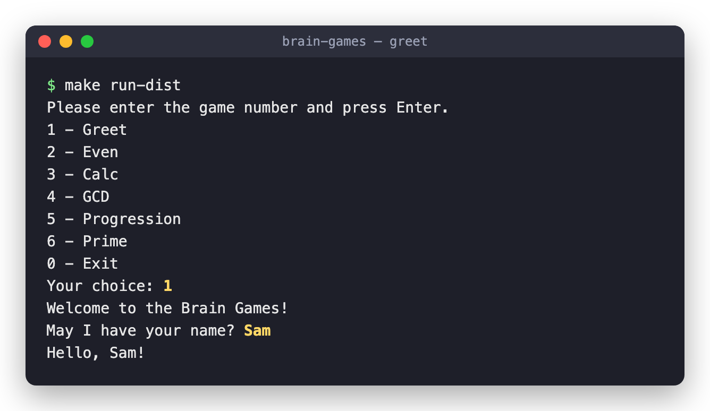

### Проверка на чётность

| Победа | Поражение |
| --- | --- |
| 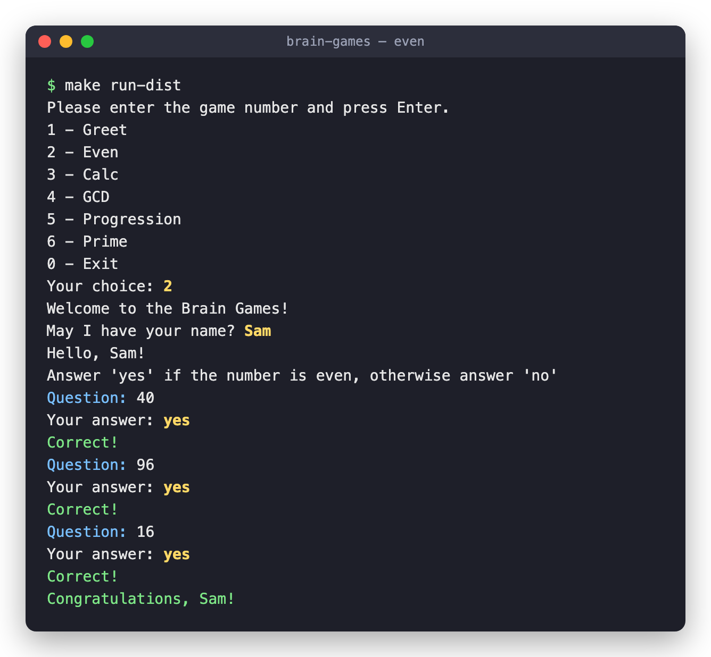 | 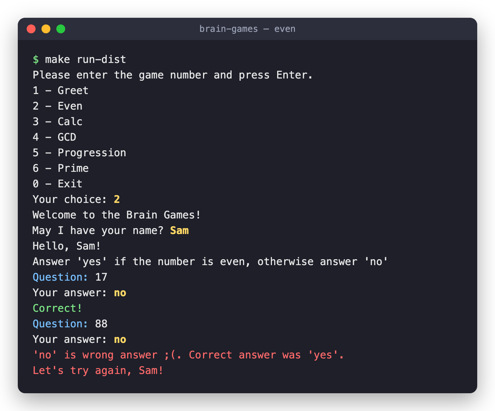 |

### Калькулятор

| Победа | Поражение |
| --- | --- |
| 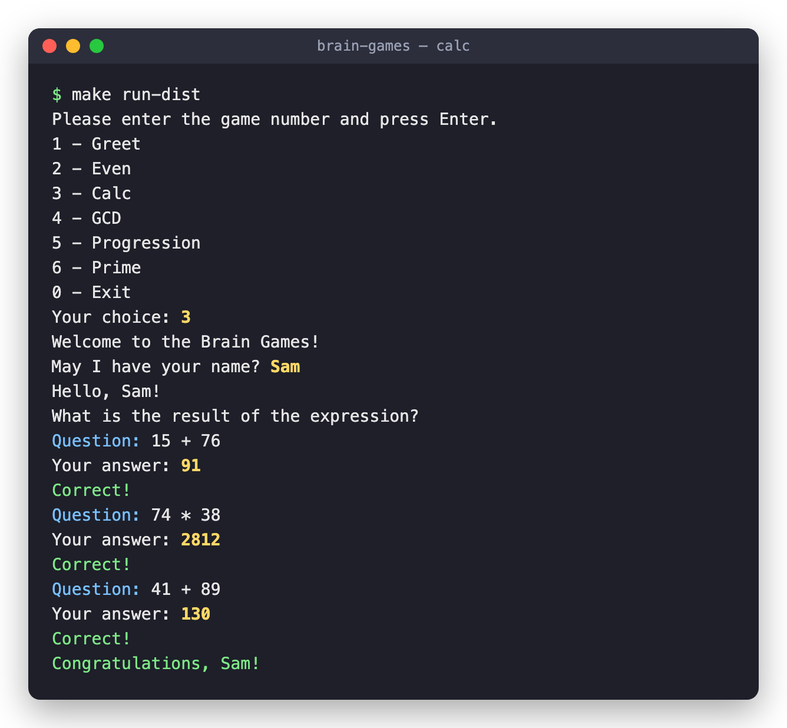 | 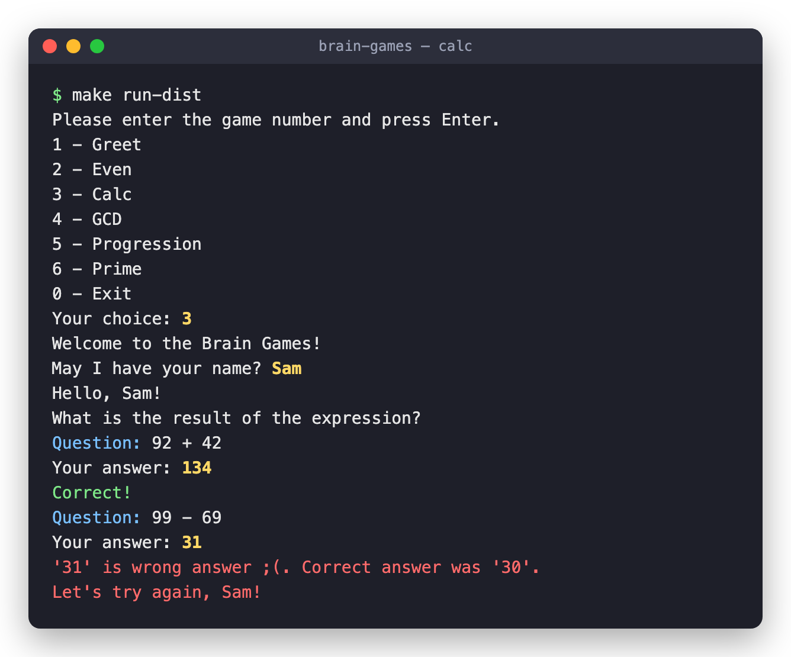 |

### НОД

| Победа | Поражение |
| --- | --- |
| 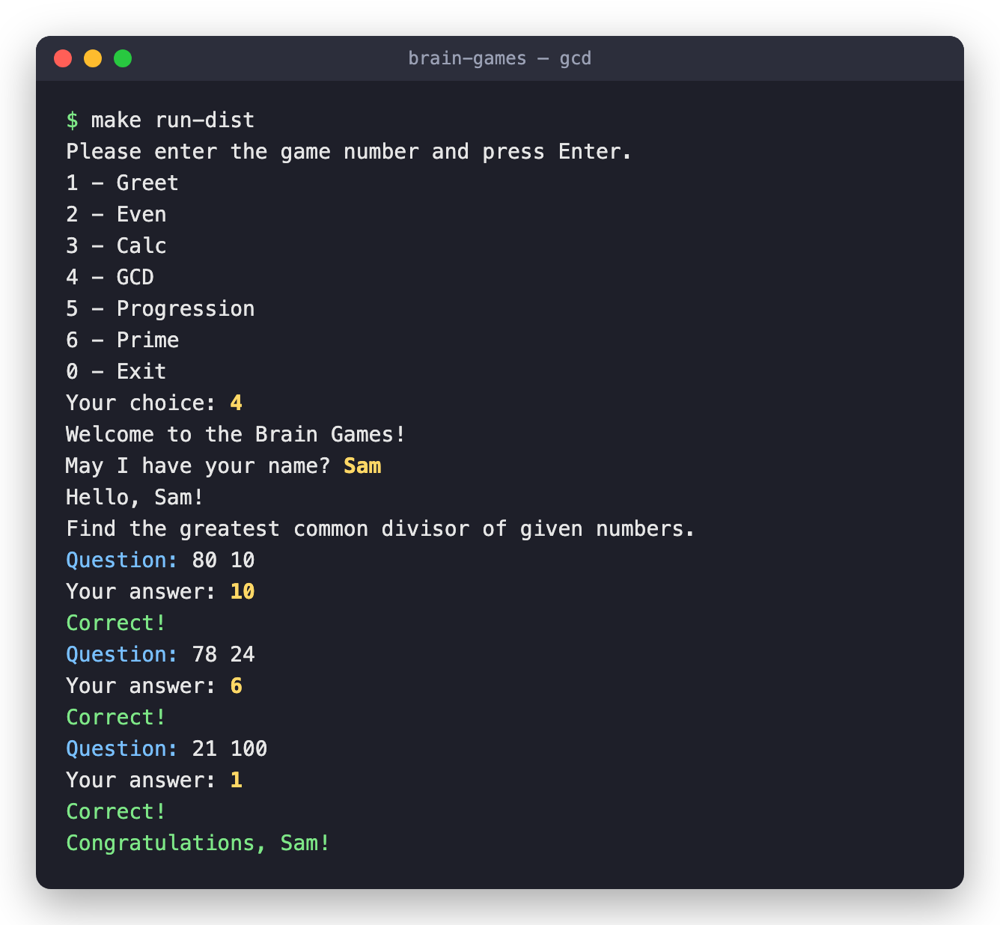 | 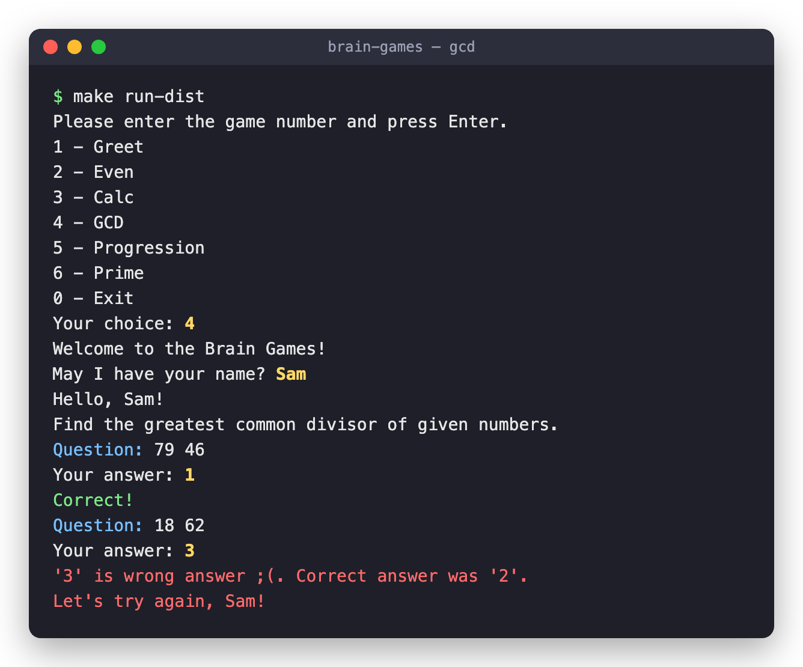 |

### Арифметическая прогрессия

| Победа | Поражение |
| --- | --- |
| 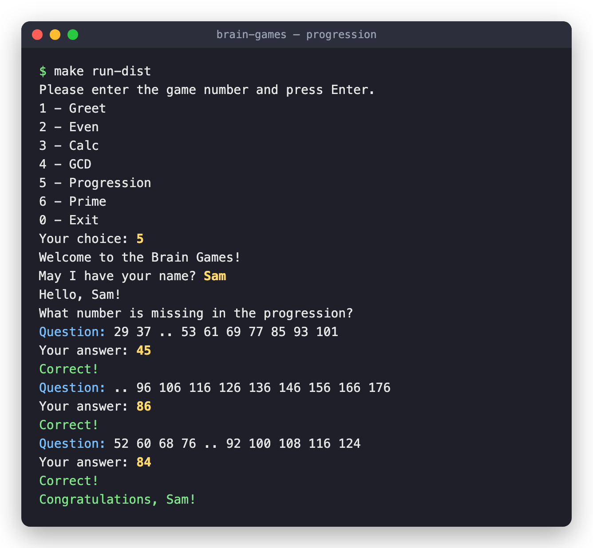 | 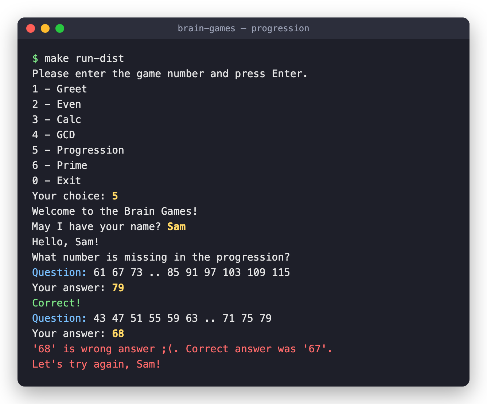 |

### Простое ли число?

| Победа | Поражение |
| --- | --- |
| 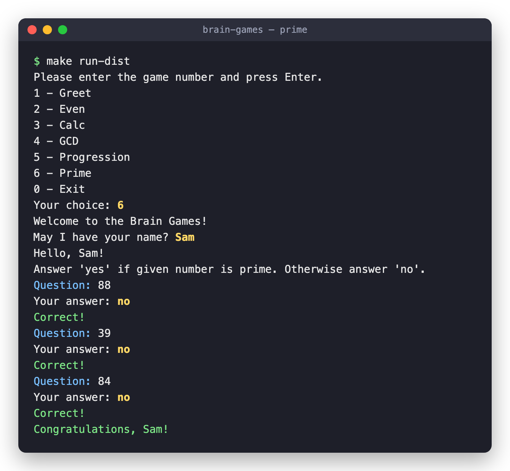 | 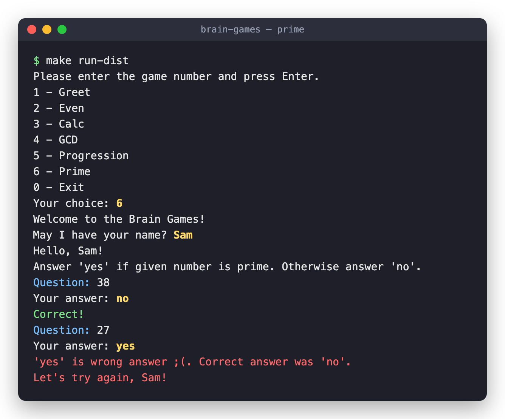 |

---

<details>
<summary>Автоматические тесты Хекслета</summary>

Тесты запускаются на каждый коммит. За запуск отвечает файл `.github/workflows/hexlet-check.yml` — не удаляйте и не переименовывайте ни его, ни репозиторий.

</details>

## О Хекслете

[Хекслет](https://ru.hexlet.io/) — школа программирования: авторские программы обучения с практикой, поддержкой наставников и реальными проектами, которые остаются в резюме. Этот репозиторий — один из таких проектов.
